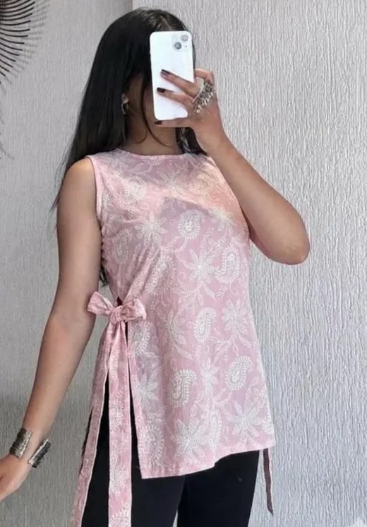
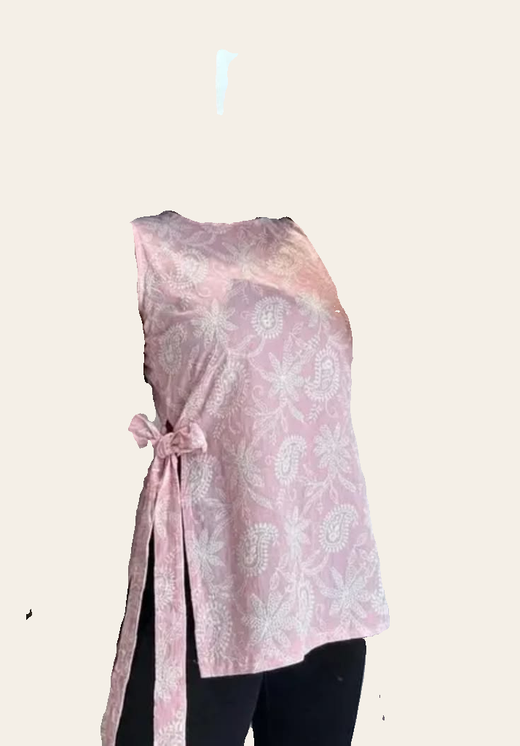

# Garment extraction — current problem & options

_Last updated: 29 Jul 2026_

## TL;DR
When a user adds a clothing photo, we process it before saving: **remove everything that
isn't the garment**, then tag it. The extraction step is not good enough yet, and we'd like
input on which direction to take.

We recently switched the extraction model and **traded one problem for another**:

| Version | Behaviour | Problem |
|---|---|---|
| **Before** (rembg, `u2net`) | Removed the **background** only | If the photo was worn on a body, the **whole person stayed** — face, arms, legs |
| **Now** (`segformer_b2_clothes`) | Removes the **background _and_ the body** | The cutout is **not clean** — jagged edges, other garments (leggings) kept, stray fragments |

Neither is production-quality for on-body photos.

## Example (real output from our live pipeline)

**Input** — the garment as the user photographs it (worn, on a body):

**Current output** — after `segformer_b2_clothes` (background on = app colour, for visibility):

What's wrong with the current output:
- **Ragged edges** — the segmentation mask is low-resolution (~512px), so borders are jagged.
- **Kept the leggings** — SegFormer keeps *all* clothing classes, and leggings map to the
  "pants" class, so they survive even though they're a different garment.
- **Stray fragments** — a bit of the phone/hand at the top, specks on the left.
- **Skin bleed** — a patch of shoulder/arm survived on the top-right.

Knock-on effect: the messy cutout also **confuses the tagger** — this pink paisley *kurti*
gets categorised as a plain "Top", because the ragged sleeveless shape reads like a tunic.

## Why this is hard (the root cause)
Both approaches above are **masking** — they keep or discard *existing pixels*. Masking has
hard limits it can never beat:
- Edges are only as clean as the mask resolution → jagged.
- It can only keep/drop whole segmentation classes → the leggings problem.
- It **cannot reconstruct** anything hidden behind an arm → holes/artefacts.

The apps that extract clothes "in best form" (e.g. Google Photos Wardrobe / Doppl) do **not**
mask — they use **generative diffusion models** trained on huge fashion datasets that *redraw*
the garment as a clean product image, and (crucially) match many items against a
billions-strong product catalogue and just use the retailer's studio photo. That is out of
reach for us (GPU fleet + proprietary data + a global Shopping Graph).

## Options to evaluate

### A. Managed background-removal API + guide flat photos  ← recommended
Drop body-removal. Use a dedicated, high-quality **background-removal** API and nudge users to
photograph items **flat / on a hanger / plain background** (this is what Whering, Indyx, Save
Your Wardrobe actually do). No body to remove, clean edges, no cold starts.

| Service | Edge quality | Cost |
|---|---|---|
| Photoroom API | very good, product-focused | ~$0.02 / image (25 free/mo) |
| remove.bg | excellent (hair-level) | ~$0.20 / image (100 free/mo) |
| Clipdrop (Stability) | very good | free tier |
| `@imgly/background-removal` (in-browser) | good | **free**, runs on device |

- **Pros:** cheap/most free, clean, zero ops, no GPU, kills our cold-start problem.
- **Cons:** keeps the body on *on-body* photos → depends on the "photograph it flat" nudge.

### B. Better masking, self-hosted (BiRefNet)
Keep masking but swap SegFormer for **BiRefNet** (SOTA open segmentation, far cleaner high-res
edges), hosted on a proper serverless GPU (Modal / Replicate).
- **Pros:** free/open, much crisper edges than now, no per-image API cost.
- **Cons:** still masking → still keeps the leggings, still can't reconstruct occlusions;
  needs a GPU host.

### C. Generative extraction (closest to Google, expensive)
A diffusion-based garment-extraction API reconstructs a clean product image from an on-body
photo (e.g. Bria product tools; research: AssetDropper).
- **Pros:** genuinely "best form", handles on-body photos.
- **Cons:** per-image cost, external dependency, variable quality, overkill for our stage.

### D. Do nothing
Keep the current SegFormer output. Works, but looks rough on on-body photos (see above).

## Recommendation
**Option A.** Google-style generative extraction is the wrong tool for a wardrobe *catalogue*
and wildly out of proportion to our stage. Clean background-removal + a "lay it flat" prompt is
how the real competitors look polished, for cents (or free) per image and zero infra to run.
We'd keep the **non-clothing gate** we already added (rejects a random/non-garment upload) and,
separately, tagging the *original* clear photo would fix the "kurti → Top" mislabel.

## Related (for context): embeddings
Search currently embeds the garment *image* with a weak CLIP model, comparing text queries to
image vectors (a mismatch that makes retrieval weak). The planned fix is to embed the tagger's
rich text **description** instead (text-to-text), which is cheaper, needs no image model, and
fixes retrieval — independent of whichever extraction option we pick above.

---

_Current stack for reference: a HuggingFace Space (FastAPI, free CPU) running the
background/garment model + CLIP `ViT-B/32` for embeddings; called from
`web/src/app/api/items/process/route.ts` → `web/src/lib/processor.ts`._
